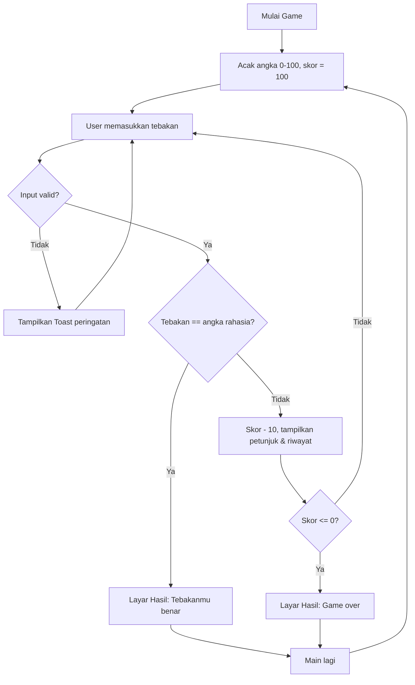

# Tebak Angka – Aplikasi Android

Aplikasi **Tebak Angka** adalah permainan sederhana berbasis Android yang menantang pengguna untuk menebak sebuah angka rahasia antara **0 sampai 100**. Setiap tebakan yang salah akan mengurangi skor, dan aplikasi akan memberikan petunjuk apakah tebakan terlalu kecil atau terlalu besar.

---

> Proyek ini dibuat untuk memenuhi tugas **Ujian Tengah Semester (UTS)** mata kuliah **Mobile Programming**.

## Pembuat

| No | Nama | NIM | GitHub |
|---|---|---|---|
| 1 | Samuel Jeremiah | 235314009 | [SamuelJHS](https://github.com/SamuelJHS) |
| 2 | Gabriel Sebastian Wale Meo | 235314042 | [GabrielWale](https://github.com/GabrielWale) |

| Keterangan | Detail |
|---|---|
| Program Studi | Informatika |
| Mata Kuliah | Pemrograman Perangkat Bergerak |
| Jenis Tugas | Proyek UTS |

---

## Tampilan Aplikasi

> Tambahkan screenshot di sini, misalnya:
> `` dan ``

Aplikasi memiliki dua layar utama dengan tema gelap (*dark mode*):

1. **Layar Bermain** – menampilkan skor, progress bar skor, kotak petunjuk, kolom input angka, tombol **Tebak**, dan riwayat tebakan sebelumnya.
2. **Layar Hasil** – muncul saat tebakan benar (ikon ✓ hijau) atau saat skor habis (ikon ✕ merah), berisi angka rahasia, skor akhir, jumlah percobaan, dan tombol **Main lagi**.

---

##  Fitur

-  Angka rahasia diacak otomatis (0–100) setiap permainan baru
-  Sistem skor: mulai dari **100**, berkurang **10** setiap tebakan salah
-  Progress bar yang menunjukkan sisa skor
-  Petunjuk **↑ Terlalu kecil** atau **↓ Terlalu besar**
-  Riwayat tebakan sebelumnya beserta arah petunjuknya
-  Penghitung jumlah percobaan
-  Tombol refresh di pojok kanan atas untuk memulai ulang kapan saja
-  Validasi input (tidak boleh kosong dan harus di antara 0–100)
-  Game over otomatis saat skor mencapai 0


## Cara Penggunaan

1. Buka aplikasi **Tebak Angka**.
2. Masukkan angka antara **0 sampai 100** pada kolom input.
3. Tekan tombol **Tebak**.
4. Perhatikan petunjuk yang muncul:
   - **↑ Terlalu kecil, coba lebih besar** → angka rahasia lebih besar dari tebakanmu.
   - **↓ Terlalu besar, coba lebih kecil** → angka rahasia lebih kecil dari tebakanmu.
5. Setiap tebakan salah mengurangi skor sebanyak 10 poin.
6. Jika tebakan benar, muncul layar **"Tebakanmu benar"** beserta skor akhir dan jumlah percobaan.
7. Jika skor habis (0), muncul layar **"Game over! Skor habis"** dan angka rahasia ditampilkan.
8. Tekan **Main lagi** (atau ikon 🔄) untuk memulai permainan baru.

---

##  Alur Logika Program



---

##  Teknologi yang Digunakan

| Komponen | Keterangan |
|---|---|
| Bahasa | Kotlin |
| UI | XML Layout (LinearLayout, FrameLayout, MaterialButton) |
| IDE | Android Studio |
| Build Tool | Gradle (Kotlin DSL) |
| Min SDK | 24 (Android 7.0) |
| Target SDK | 37 |
| Java Version | 11 |

---

##  Struktur Proyek

```
app/src/main/
├── java/com/example/menebakangkasimpananaplikasi/
│   └── MainActivity.kt          # Logika permainan
├── res/
│   ├── layout/activity_main.xml # Tampilan utama
│   ├── drawable/                # Background kartu, chip, progress bar, ikon
│   └── values/                  # Tema, warna, string
└── AndroidManifest.xml
```

---

##  Cara Menjalankan

1. Clone repository ini:
   ```bash
   git clone https://github.com/SamuelJHS/Menebakangkasimpananaplikasi.git
   ```
2. Buka folder proyek di **Android Studio**.
3. Tunggu proses *Gradle Sync* selesai.
4. Jalankan di emulator atau perangkat Android dengan menekan tombol **Run ▶**.

---

##  Kesimpulan

Aplikasi Tebak Angka ini menerapkan konsep dasar pemrograman Android seperti penggunaan **Activity**, **View binding manual (`findViewById`)**, **event listener** pada tombol, **percabangan (`when`)**, **pembangkitan angka acak (`Random`)**, serta pengaturan **visibilitas view** untuk berpindah antar tampilan. Aplikasi ini juga dilengkapi tampilan modern bertema gelap agar nyaman digunakan.

---

© 2026 Samuel Jeremiah & Gabriel Sebastian Wale Meo – Informatika
